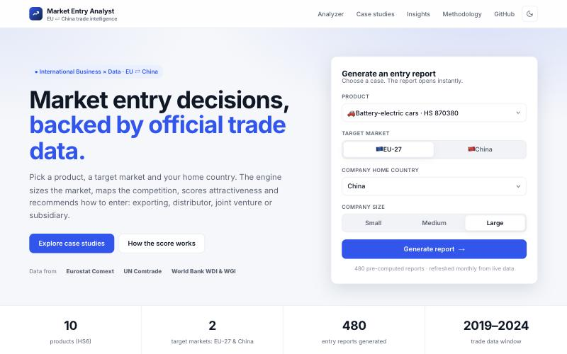
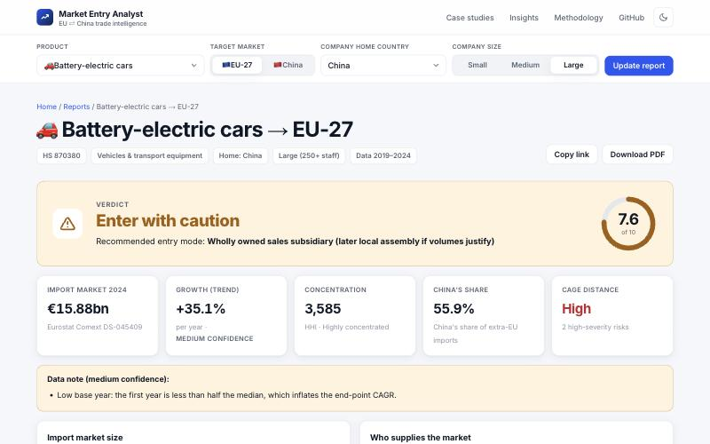
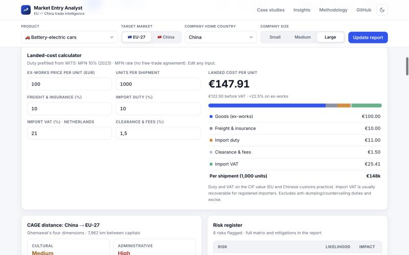

# 🌍 Market Entry Analyst: EU ⇄ China

[](https://github.com/onurusalan/ai-market-entry-analyst/actions/workflows/ci.yml)
**Live app:** https://onurusalan.github.io/ai-market-entry-analyst/ (interactive analyzer, no sign-up)

**A data platform that turns official trade statistics into consulting-style market entry decisions for the EU and Chinese markets.**

Pick a product, a target market (EU-27 or China), the company's home country and its size. The platform pulls data from **Eurostat, UN Comtrade, the World Bank and WITS**, applies International Business frameworks in code (**PESTEL, CAGE distance, HHI, OLI entry-mode logic**) and returns a verdict, the applicable import duty, a landed-cost model, the company's competitive starting position, a risk matrix and a 90-day plan.

Everything runs on **free public data**. No paid service is needed.



---

## ✨ What it does

| | Feature | Details |
|---|---|---|
| 📄 | **Entry report** | Verdict, market sizing, competition, starting position, PESTEL, CAGE, tariffs, regulation checklist, risk matrix, entry mode, 90-day plan |
| 💶 | **Tariffs & landed cost** | MFN applied tariff from WITS (UNCTAD TRAINS), FTA preferences, and an interactive landed-cost calculator (freight, duty, trade-defence duty, VAT, fees) |
| 🧭 | **Competitive position** | The home country's rank, market share trend and price level (unit value per kg vs the market average) |
| 🛡️ | **Data-quality checks** | Flags small markets, HS-code changes (HS2022) and low base years; growth is measured with a log-linear trend and shrunk towards neutral when data are unreliable |
| ⚖️ | **Sensitivity analysis** | Re-scores every case under six weighting schemes and flags verdicts that depend on the weights |
| ✅ | **Backtest** | Out-of-sample test of the EU-27 country ranking against what actually happened in the following four years |
| 🇪🇺 | **EU-27 ranking** | Ranks all member states on demand, growth, purchasing power, logistics and institutions, with a map |
| 📈 | **Insights** | Cross-product data stories: the EU's dependency on Chinese supply and the EU's position in China |
| 🌐 | **Web app** | 10 products × EU-27/China × 16 home countries × 3 company sizes = 480 reports on GitHub Pages; dark mode, PDF export, mobile layout, accessible charts |
| 🖥️ | **Streamlit app** | Any HS6 code and year range, market dashboard, ranking and calculator (run locally) |
| 🤖 | **Optional AI agent** | Experimental Claude tool-use agent with web search (bring your own key) |





### Case studies on the live site

| Case | Verdict | Recommended entry mode |
|---|---|---|
| 🚗 Battery-electric cars: China → EU-27 | Enter with caution | Wholly owned sales subsidiary |
| 🚲 E-bikes: Taiwan → EU-27 | Enter with caution | Exclusive distributor + small sales office |
| 🧴 Skincare: France → China | Enter | Cross-border e-commerce first, then a distributor |
| 💊 Medicaments: Germany → China | Enter | Joint venture or licensing |
| 🔋 Lithium-ion batteries: Korea → EU-27 | Enter with caution | Wholly owned sales subsidiary |
| 🌡️ Heat pumps: Japan → EU-27 | Enter | Wholly owned sales subsidiary |
| 🍷 Bottled wine: Italy → China | Enter with caution | Exclusive Chinese importer-distributor |
| 🪑 Wooden furniture: Vietnam → EU-27 | Enter with caution | Exporting via importers and distributors |

*(Verdicts are regenerated from the latest data each month.)*

## 🧪 Example insights (real data)

- **E-bikes (HS 871160) → EU-27:** extra-EU imports of **€1.57 bn** in 2024; **China supplies 53.5%**, Taiwan 22.5%. HHI **3,476** (highly concentrated). Taiwanese e-bikes sell at **€57.6/kg vs a €17.3/kg market average** (premium position, 3.3×). The EU's MFN duty is **6%**, so landed cost is about **+18% on ex-works** before VAT.
- **Clean-tech dependency:** China supplies **97% of the EU's solar-module imports, 86% of lithium-ion batteries and 60% of heat pumps**.
- **Bottled wine → China:** China's MFN tariff is **14%**; with freight and fees an Italian bottle lands at about **+27% on ex-works** before VAT, while Australia (duty-free under its FTA) holds the top supplier position.

## ✅ Validation

The EU-27 ranking was rebuilt with data up to 2020 only and compared with 2020-2024 outcomes for 9 products:

| Metric | Result |
|---|---|
| Rank correlation with **new demand** (absolute import gain) | **+0.52** on average (up to 0.92 for EVs) |
| Predicted top-5 markets among the actual top-5 | **24 of 45** |
| Rank correlation with the **growth rate** | **−0.44** |

Reading: the ranking is a good guide to **where demand volume will appear**, but not to the fastest-growing markets (small, fast-growing markets tend to cool down). That is why the score uses growth only as one of five components. Caveat: country fundamentals use current values.

## 🏗️ Architecture

```
┌──────────────────────────────────────────────────────────────────┐
│ Data layer: src/data_sources.py                                  │
│  Eurostat Comext · UN Comtrade · World Bank WDI/WGI · WITS       │
│  retries · rate-limit handling · on-disk cache                   │
└──────────────────────────────┬───────────────────────────────────┘
                               ↓
┌──────────────────────────────────────────────────────────────────┐
│ Analysis layer: src/analysis.py                                  │
│  market size · trend growth · data-quality flags · unit values   │
│  HHI · score · sensitivity · EU-27 ranking · backtest            │
└──────────────────────────────┬───────────────────────────────────┘
                               ↓
┌──────────────────────────────────────────────────────────────────┐
│ Decision layer: src/report_engine.py (analyse_case → Case)       │
│  rendered by src/report_markdown.py, one function per section    │
│  knowledge base: src/knowledge.py                                │
│  PESTEL · CAGE · tariffs · landed cost · competitive position    │
│  risk matrix · entry-mode rules · 90-day plan                    │
│  curated regulation knowledge base with sources and review date  │
│  (optional) src/agent.py: Claude tool-use agent + web search     │
└──────────────────────────────┬───────────────────────────────────┘
                               ↓
┌───────────────────────────────┐   ┌──────────────────────────────┐
│ app.py: Streamlit app         │   │ scripts/build_site.py →      │
│ any HS6 code, run locally     │   │ JSON data + site/ front end  │
│                               │   │ (HTML/CSS/JS, Plotly) → Pages│
└───────────────────────────────┘   └──────────────────────────────┘
        both use src/catalog.py (one product and country catalogue)
```

## 🚀 Quick start

```bash
git clone https://github.com/onurusalan/ai-market-entry-analyst.git
cd ai-market-entry-analyst
python3 -m venv .venv && source .venv/bin/activate
pip install -r requirements.txt -r requirements-dev.txt   # installs the package in editable mode
streamlit run app.py
```

Command-line interface (installed as `market-entry`, or `python -m src.cli`):

```bash
market-entry report --hs 871160 --target EU --home TW --size medium -o ebikes.md
market-entry report --hs 220421 --target CN --home IT --json      # machine-readable output
market-entry rank --hs 870380 --top 10                            # EU-27 member-state ranking
market-entry tariff --hs 850760 --target CN --home KR             # MFN vs preferential duty
```

Developer commands:

```bash
pytest --cov                    # offline tests (fake network, recorded API answers); fails under 80% coverage
ruff check .                    # lint
mypy                            # static type check of src/
python scripts/build_site.py    # rerun all 480 reports and rebuild the web app into docs/
```

Optional environment variables (see `.env.example`): `COMTRADE_API_KEY` (free, faster China data) and `ANTHROPIC_API_KEY` (experimental AI narrative).

## ☁️ Deploy the Streamlit app (free)

The web app is already live on GitHub Pages. To also host the Streamlit app (any HS6 code, custom year ranges):

1. Sign in at [share.streamlit.io](https://share.streamlit.io) with GitHub.
2. **Create app** → repository `onurusalan/ai-market-entry-analyst`, branch `main`, file `app.py` → **Deploy**.

No secrets are required: the app runs fully on public data.

## 📊 Visitor analytics (optional, free)

Cookie-free page-view counting with [GoatCounter](https://www.goatcounter.com/) is built in but off by default:

1. Create a free GoatCounter account and pick a code, e.g. `market-entry` (dashboard at `market-entry.goatcounter.com`).
2. In the GitHub repository: **Settings → Secrets and variables → Actions → Variables → New variable**, name `GOATCOUNTER_CODE`, value your code.
3. Run the **Refresh web app data** workflow once (Actions tab → Run workflow). Counting starts with that build.

## 📐 Methodology

**Market size.** Imports into the target market proxy addressable demand: extra-EU imports (Eurostat `EXT_EU27_2020`) for the EU and China-reported imports (UN Comtrade, excluding re-imports of Chinese goods) for China.

**Growth and data quality.** Growth is the log-linear trend over all usable years (less sensitive to one unusual year than the end-point CAGR, which is also shown). Years below 5% of the peak are treated as a series break (for example a new HS2022 code). Markets below 50 million and low base years are flagged. Confidence is High, Medium or Low; at Medium the growth sub-score is shrunk 25% towards neutral, at Low 50%.

**HHI.** Sum of squared supplier shares (%): below 1,000 is unconcentrated, 1,000 to 1,800 is moderately concentrated, above 1,800 is highly concentrated.

**Attractiveness score (0-10).**

| Component | Weight | Formula |
|---|---|---|
| Market size | 25% | 2 × (log10(value) − 6) |
| Growth | 25% | 5 + trend growth / 3 (shrunk by data confidence) |
| Competitive openness | 20% | 10 − HHI / 1000 |
| Institutional quality | 15% | mean of 4 World Bank WGI scores, rescaled |
| Logistics | 15% | (LPI − 1) × 2.5 |

**Sensitivity.** The sub-scores are re-weighted under equal, size-led, growth-led, risk-averse and niche-entrant schemes. If the verdict band changes, the report labels the verdict as borderline.

**Tariffs and landed cost.** MFN applied tariff (simple average across national tariff lines) from WITS / UNCTAD TRAINS, latest available year. Where WITS publishes a partner-specific preferential rate (FTA or GSP partners, latest year available, often with a 2-4 year lag) that rate is used; otherwise FTA partners are assumed to pay 0% if rules of origin are met. Landed cost = goods + freight/insurance (3/6/10% by distance) + duty on the CIF value + clearance (1.5%) + import VAT on CIF + duty.

**Competitive position.** The home country's rank and share among all suppliers, its share change over the period, and its unit value per kg vs the market average (premium ≥ 1.25×, value ≤ 0.8×).

**CAGE distance** (Ghemawat, 2001). Cultural distance from language-family overlap. Administrative distance from single market, FTA or none, plus the governance gap. Geographic distance between capitals: below 1,500 km is low, below 5,000 km is medium. Economic distance from the GDP per capita ratio: below 1.5× is low, below 3× is medium.

**Entry mode.** Rules follow transaction-cost and OLI logic. High distance, low attractiveness or small firms lead to low-commitment modes (exporting, distributors, cross-border e-commerce). Attractive markets with strong institutions and large firms lead to subsidiaries or a WFOE. Regulated sectors in China (pharma, medtech) lead to a JV or licensing. The home country's existing presence and price level refine the reasoning.

**EU-27 ranking.** Demand 40% (total imports, log scale), growth 25%, GDP per capita 15%, logistics 10%, institutions 10%.

**Regulatory knowledge base.** Each sector note links to the official legal text or regulator; notes carry a compilation date and are flagged as due for review after 12 months.

**Limitations.** Imports are a demand proxy, not total consumption. Hubs such as the Netherlands and Belgium re-export. Unit values mix product grades. Partner-specific preferential rates in WITS lag by several years and are missing for some agreements, in which case the FTA rate is an assumption. Regulatory notes are curated and must be verified on the official sources linked in each report; they are not legal advice.

## 🗺️ Roadmap

- [x] Tariff lookup (WITS / UNCTAD TRAINS MFN rates)
- [x] Landed-cost calculator (duties, freight, VAT, trade-defence duty)
- [x] Data-quality checks, sensitivity analysis and backtest
- [x] PDF export (print-optimised report page)
- [x] Partner-specific preferential rates (WITS, FTA and GSP partners)
- [ ] Current-year preferential rates from EU TARIC and China's tariff schedule
- [x] Trade-policy watch (curated, dated notes with official sources)
- [x] Member-state VAT selector in the landed-cost calculator
- [ ] Automated trade-defence tracker (needs a machine-readable feed of EU and MOFCOM cases)
- [ ] Full member-state target reports and services trade (needs a different data source)

## 🛠️ Tech stack

Python · pandas · REST APIs (Eurostat SDMX/JSON-stat, UN Comtrade, World Bank, WITS SDMX) · Streamlit · Plotly · vanilla HTML/CSS/JavaScript · argparse CLI · pytest + coverage · ruff · mypy · GitHub Actions · GitHub Pages · optional Anthropic Claude API

---

*Built by Onur Usalan (MSc International Business, BSc Management Information Systems).*
